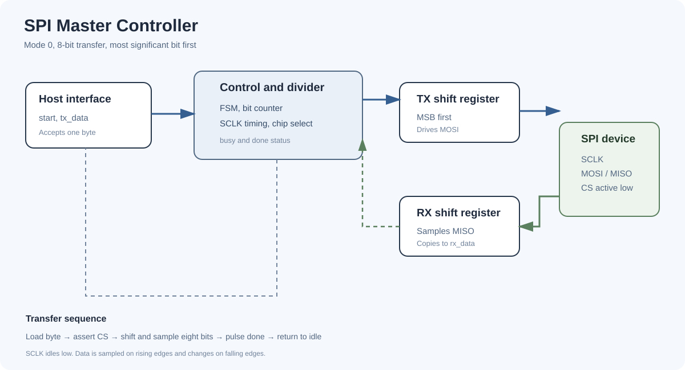
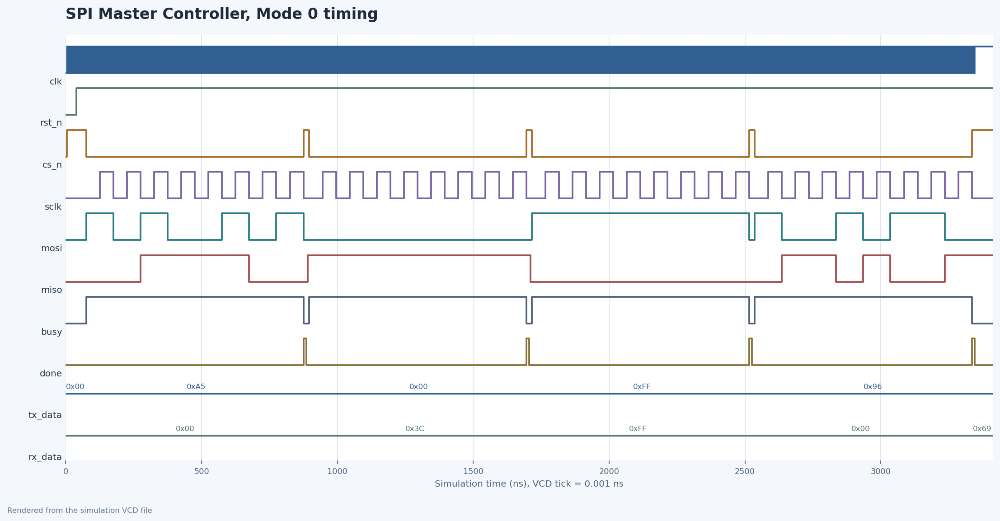

# SPI Master Controller

This project implements a small SPI master for practising serial data transfer and clocked shift registers in Verilog. It handles one 8-bit word per start pulse and follows SPI Mode 0.

The master sends the most significant bit first, samples MISO on rising SCLK edges, and changes MOSI on falling edges. The `CLKS_PER_HALF` parameter controls the SCLK divider.



## Interface

| Signal | Direction | Description |
| --- | --- | --- |
| `clk`, `rst_n` | Input | System clock and active-low reset |
| `start` | Input | One-clock request while idle |
| `tx_data[7:0]` | Input | Byte to transmit |
| `miso` | Input | Data from the peripheral |
| `rx_data[7:0]` | Output | Received byte |
| `busy`, `done` | Output | Transfer status and one-clock completion pulse |
| `sclk`, `mosi`, `cs_n` | Output | SPI signals |

## Run it

Install Icarus Verilog and Python with Matplotlib. From the repository folder, run:

```bash
bash scripts/run_sim.sh
```

The testbench exchanges four byte patterns with a behavioural slave model. The script runs `CLKS_PER_HALF` values of 1, 2, and 5.

## Simulation output

The workflow runs the same testbench on GitHub. The log and waveform files below are generated by Icarus Verilog.



[Open the VCD file](docs/waveforms/spi_master.vcd) · [Read the simulation log](docs/waveforms/simulation.log)

## What is not covered

This version does not include SPI Modes 1 to 3, multiple chip selects, variable word lengths, or a streaming interface.

Sai Teja
